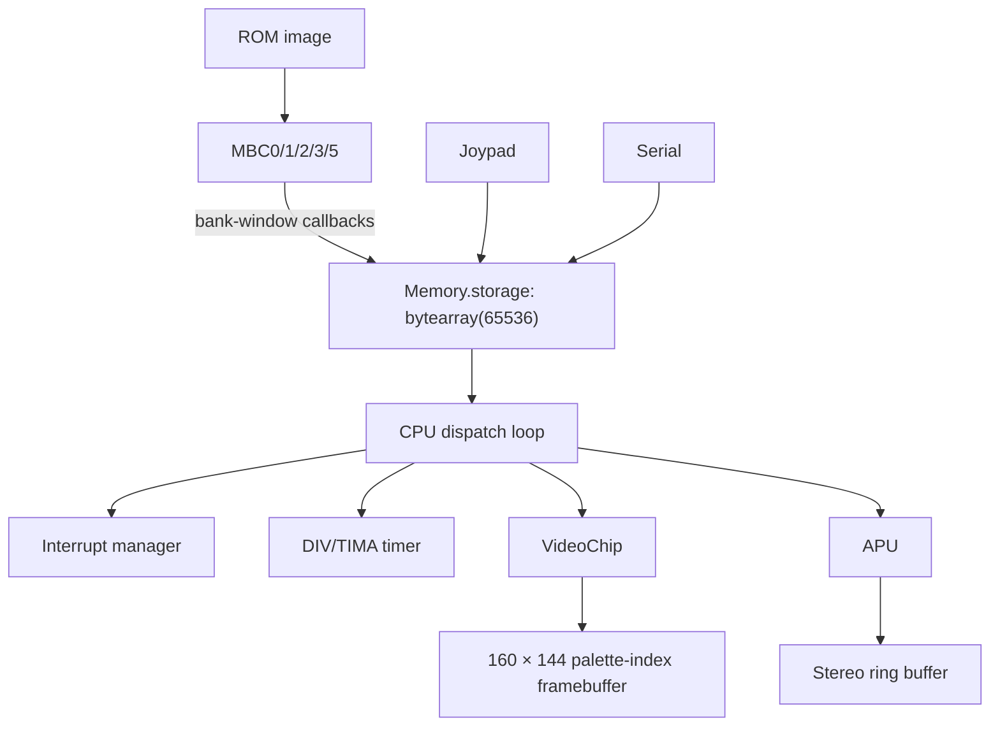

# PyGameBoy architecture

PyGameBoy is a DMG emulator optimized for CPython without moving the CPU core
into a native extension. This document describes the current implementation,
including the boundaries where speed is deliberately traded for accuracy or
debuggability.

## System map



## 1. Flat memory with routed writes

Most CPU reads use a single 64 KiB `bytearray`. A read such as instruction fetch
is therefore a direct index operation:

```python
opcode = memory[registers.PC]
cycles = dispatch[opcode]()
```

Writes cannot all be direct because cartridge control ranges, mirrored WRAM,
I/O registers, DMA, and audio registers have side effects. `Memory.write_byte`
routes them through a 256-entry table indexed by the high address byte:

```python
write_pages[address >> 8](address, value)
```

### Cartridge-window invariant

`Memory.storage[0x0000:0x8000]` and `Memory.storage[0xA000:0xC000]` must always
represent what the CPU can currently observe. MBC bank-change callbacks replace
whole visible windows. Incremental RAM-write callbacks preserve
controller-specific behavior without copying 8 KiB on every save-RAM write:

- MBC2 stores four-bit values, exposes the upper nibble as ones, and mirrors
  each 512-byte location throughout the 8 KiB external-RAM window.
- MBC3 RTC registers, when selected, appear across the external-RAM window.
- Banked RAM writes update the active flat address while retaining data in the
  selected physical bank.

Integration tests exercise these rules through `Memory`, because testing an MBC
object alone cannot detect a stale flat mirror.

## 2. CPU dispatch and instrumentation

The CPU builds a 256-entry list of bound opcode methods during initialization.
Normal execution caches frequently used objects and callables as local
variables, then dispatches directly from the flat memory buffer.

`CPU.run(fast=False)` intentionally uses the public `step()` path. It is slower,
but provides a stable place for debuggers and future tracing. Opcode profiling
is opt-in and accumulates counts in a fixed 256-entry list; the fast path pays
no counting cost when profiling is disabled.

Opcode bodies are explicit Python methods. Some hot register operations are
inlined against the register bytearray, while their string-register
compatibility paths remain available for tests and instrumentation. CB-prefixed
instructions decode their register and operation directly instead of creating
per-instruction wrapper calls or operand tuples. This improves throughput at
the cost of some deliberate repetition. `refactor.py` is a guarded,
dry-run-by-default historical rewrite tool; importing it never changes source
code.

Instructions with externally observable multi-cycle bus activity advance the
timer at their actual read and write phases. This covers immediate-address,
CB-prefixed, and read-modify-write timing without turning every opcode into a
micro-op interpreter. Blargg's `mem_timing` and `mem_timing-2` suites lock those
phases at the system level.

## 3. PPU rendering

The PPU advances through OAM search, pixel transfer, HBlank, and VBlank using
cycle counts. Background and window spans fetch at most 21 tile rows through
NumPy, then decode their two bitplanes with a read-only 65,536-entry lookup
table. A second lookup table maps raw two-bit colors through each DMG palette.
This removes per-pixel shifts and temporary 160-element coordinate arrays while
preserving signed tile addressing, wrapping, and negative window positions.

Sprite selection scans the 40 OAM entries in hardware order and stops after the
first ten visible objects. Priority sorting remains bounded to those ten
entries, and the final overlay uses short Python loops over their visible
pixels. Describing the entire sprite path as vectorized would be inaccurate;
the lookup-table/Python hybrid keeps priority behavior straightforward while
bounding both allocation and Python work.

The renderer produces palette indices rather than RGB pixels. The display loop
maps the complete frame through a four-color NumPy palette and transfers it to
Pygame.

Current limitation: timing is scanline based rather than a dot-accurate pixel
FIFO. Mid-scanline register effects and some access restrictions are therefore
not yet modeled.

## 4. APU and pacing

The APU advances oscillator state in base-clock units and emits 44.1 kHz stereo
samples into a fixed-size NumPy ring buffer. A lock protects read/write
positions shared with the `sounddevice` callback. CPU execution batches audio
work up to 8,192 base-clock cycles, flushing earlier cycles before sound-register
accesses or DIV writes and flushing residual cycles on every run boundary.

Pulse and wave oscillators integrate the area under each digital waveform while
landing on its exact final phase. Noise uses LFSR lookup tables for both seven-
and fifteen-bit modes. Long intervals with unchanged registers generate waveform
areas in NumPy blocks; a scalar implementation remains as a tested reference
and handles short intervals. Small, bounded caches hold waveform prefix sums.
NR50/NR51 routing, gain, and DAC enable masks are recomputed only when their
controlling registers change.

Pan Docs documents the DMG DAC, mixer, and analog high-pass capacitor in the
hardware references below. The sample producer maps each active 4-bit channel
DAC to its bipolar analog range (digital zero is positive), applies NR50's
`(volume + 1)` gain, and advances the DMG high-pass capacitor. Waveform integration
feeds an 88.2 kHz intermediate stream, then a 64-tap windowed-sinc low-pass filter
with an 18 kHz cutoff precedes decimation to 44.1 kHz. Half-scale nominal mixing
leaves headroom for AC-coupled transients. The capacitor, fractional sample phase,
and convolution tail survive run boundaries and rewind; the callback only drains
already-formed samples. Its block size cannot change their waveform.

Channel 1 includes the 128 Hz sweep timer, shadow frequency, trigger overflow,
second overflow check and negate-mode disable. Pulse retriggering preserves duty
phase. Live duty and wave-volume changes take effect without retriggering, and
envelope changes update the channel output immediately. Wave RAM remains writable
while powered off; DMG playback enforces its access window and retrigger corruption.
NR52 transitions reset channel control while preserving DMG length counters and
wave RAM. DIV writes can clock the sequencer through a falling edge.
Color cartridges select CGB APU behavior: powered-off length writes are ignored,
power-off clears length counters, active wave RAM accesses select the byte being
played without the DMG access window, and retriggering does not corrupt wave RAM.
The CGB high-pass capacitor uses its own charge factor (`0.998943` per base-clock
cycle, versus DMG's `0.999958`). CPU double speed still advances audio in base-clock
units. Tests compare pitch, sample count, and waveforms at both CPU speeds.
NR52 power-off periods still produce clocked silence for stable host pacing, and
a true host underrun is zero-filled rather than extending a stale DC sample.

With audio enabled, buffer depth acts as the pacing signal:

- A deep buffer pauses CPU production while the audio device drains it.
- A shallow buffer can skip host rendering while emulation and audio continue.
- If audio is disabled or unavailable, Pygame's clock supplies frame pacing.

The shallow-queue threshold is 2,048 samples; production pauses above 4,096.
The output stream starts after window and font initialization, with 2,048 silent
host samples priming the queue. This avoids consuming an empty queue during UI
setup and does not advance the emulated clocks.
During HALT, the fast CPU path coalesces idle four-cycle polls up to the next
existing peripheral-dispatch boundary or TIMA overflow. It retains the same
virtual idle count and interrupt timing. Serial transfers and pending IME changes
keep the ordinary polling path. Tests compare both paths with timers and speed modes.

This design reduces long-term clock drift, but it is not claimed to provide
perfect host-independent synchronization. Device latency, callback scheduling,
and incomplete APU hardware behavior remain measurable sources of variation.

## 5. Serial clock

The DMG serial link shifts one bit every 512 CPU cycles when SC selects the
internal clock. Transfers retain a divider phase aligned to hardware reset,
complete after eight edges, clear SC's start bit, place `0xFF` on SB when no
peer is connected, and request the serial interrupt.

The CPU advances this clock after every dispatched instruction. While no
transfer is active, it updates the divider phase inline and avoids a Python
method call; active and newly started transfers continue through the full
serial state machine. Because PyGameBoy skips Nintendo firmware by default, the
post-boot initializer seeds the divider phase observed after a DMG ABC boot.
This behavior is locked by Mooneye's `boot_sclk_align-dmgABCmgb` acceptance ROM
as well as focused unit tests.

External-clock transfers remain pending because link-cable peer emulation is
not implemented yet.

## 6. Benchmark methodology

`benchmark_cpu.py` measures one real configuration: the bytearray-backed,
max-cycle production dispatch path used for normal emulator frames. Each case
receives one warm-up, followed by multiple measured runs summarized by the
median. Reports include minimum and maximum cycle rates in JSON, along with
Python, platform, and execution-path metadata.

The benchmark does not claim full-emulator performance. PPU, APU, display,
input, and host scheduling costs are intentionally excluded. A benchmark change
should be accompanied by:

1. A correctness test for the optimized behavior.
2. Before/after JSON generated on the same host and interpreter.
3. Median results from multiple runs.
4. An explanation of any readability or accuracy tradeoff.

## Rewind history

`rewind.py` captures hardware immediately before each gameplay `CPU.run`, after
host input has been applied. `rewind_state.py` detaches the scalar metadata and
keeps bytearrays/NumPy buffers as separately aligned blocks. One complete current
hardware state is retained. Each older transition stores the preceding metadata
and compressed XOR differences for changed buffers. Unchanged buffers need no
copy in the transition. Buffer paths remain aligned even when pickle's scalar
encoding changes size. Removed, added and resized buffers are reversible.

The default history holds about ten seconds (600 intervals) and at most 64 MiB
of retained payload: the uncompressed current state plus compressed transitions,
excluding Python container headers and temporary working allocations. Oldest
reverse transitions can be evicted without breaking the remaining chain.
Rewinding applies and removes the newest transition; new captures after release
therefore create a new future without retaining abandoned branches.

The captured state includes CPU registers and execution flags, timers, delayed
interrupt enable, serial phase, the flat bus, cartridge RAM and banking state,
boot overlay, CGB banks/palettes/HDMA, PPU timing, joypad registers,
and APU registers, channel oscillators, sequencer and filter capacitors. Bytearrays
and NumPy arrays are restored in place so the CPU's cached memory reference and
the PPU's views keep observing the same allocation. Wiring, ROM images, dispatch
tables, pixel buffers, renderer caches, host input, profiling totals, audio locks
and playback buffers are excluded. Dirty cartridge flags are set after
restoration so a later battery-save flush cannot silently retain the abandoned
future.

Rewind restores the pre-frame hardware and re-executes its recorded run budget
to regenerate pixels. Normal gameplay dispatches end at VBlank, reproducing
mid-scanline palette/scroll changes as well as the final hardware state. Diagnostic
instruction/cycle limits can stop partway through a frame; replay then reproduces
only that partial drawing. Both forward and replay runs start with blank pixels
(white RGB in CGB mode), so LCD-off intervals never retain a stale host image.
A manual `capture()` with no run recipe restores hardware with a blank display.
This is frame-level undo
of hardware changes, not an inverse implementation of CPU instructions. The
full-state `SnapshotBuffer` backend is retained as a test/benchmark reference.

MBC3's time source is replaced by a frame-advanced emulated clock during history
recording, scaled for the current CPU speed. It is restored with the rest of the
machine. RTC reads have recording-interval time resolution; speed changes within
one recording interval use its final speed. This is not a cycle-accurate RTC
implementation. The persisted RTC timestamp still supports offline elapsed time
on the next cartridge load.

Holding R restores one history entry per host tick, mutes queued game audio and
plays a ten-second adaptation of a bundled CC0 tape-rewind effect. The original
short effect is time-stretched with pitch retained during asset preparation.
The sample is loaded once before the stream starts, with no callback file I/O.
Playback pads with silence after the end rather than repeating. Release
resynchronizes held keys with the restored joypad. Focus loss releases all keys.
Forward playback can skip pixel generation while a shallow audio queue recovers.
Hardware history still advances every frame, and the PPU window-line counter
advances even when pixels are skipped. Rewind forces rendering during replay,
so a frame omitted from forward presentation can still be reconstructed.

The codec uses pickle/zlib exclusively as private in-process storage. There is no
state import/export API or portable file format. Serial output and other host
side effects cannot be undone; serial callbacks are suppressed during replay to
avoid repeating output. Instruction stepping, timeline scrubbing, reverse
watchpoints and shareable recordings remain follow-up debugger work.

`tools/generate_rewind_demo.py` builds an original synthetic ROM, executes it
through the CPU/PPU, reverses hardware for the backward section, and resumes with
changed input. Its timing report includes CPU/PPU execution and history capture,
without a live window or audio device. `tools/benchmark_rewind.py` compares the
delta and full-state reference backends over identical input, checks each retained
backward frame against original hardware/pixel digests, and verifies resumed
execution. It reports capture and reverse-plus-replay timing separately. The
default ROM is original and redistributable; optional ROM/save paths are read only.

## 7. Accuracy roadmap

The highest-value remaining hardware work is:

1. Dot-accurate PPU/FIFO timing and memory-access restrictions.
2. MBC1 multicart variants and finer MBC3 RTC time resolution.
3. Channel-1 frequency sweep and cycle-exact length/envelope behavior.
4. OAM corruption behavior and remaining timer/interrupt edge cases.
5. Save states with a versioned serialization format.

## 8. Hardware and test references

These references are retained alongside the implementation so timing,
electrical-model, and conformance decisions remain auditable:

- [Pan Docs: Audio overview](https://gbdev.io/pandocs/Audio.html)
- [Pan Docs: Audio details, DACs, mixing, and DMG high-pass filter](https://gbdev.io/pandocs/Audio_details.html)
- [Pan Docs: Audio registers](https://gbdev.io/pandocs/Audio_Registers.html)
- [Mooneye Test Suite](https://github.com/Gekkio/mooneye-test-suite), with
  the exact vendored commit and fixture checksums recorded in
  [`tests/roms/mooneye/README.md`](tests/roms/mooneye/README.md)
- [Blargg Game Boy test ROM collection](https://github.com/retrio/gb-test-roms/tree/c240dd7d700e5c0b00a7bbba52b53e4ee67b5f15),
  pinned to the same commit used by the conformance workflow
- [PyGameBoy test-ROM conformance and deployment policy](docs/conformance.md)
