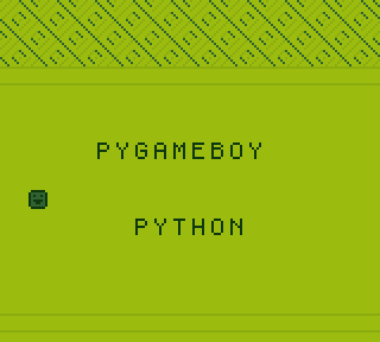
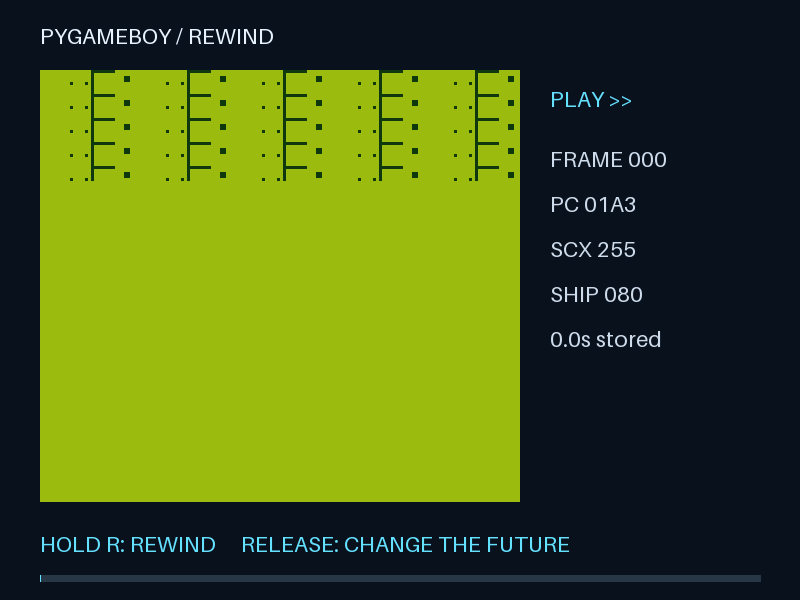
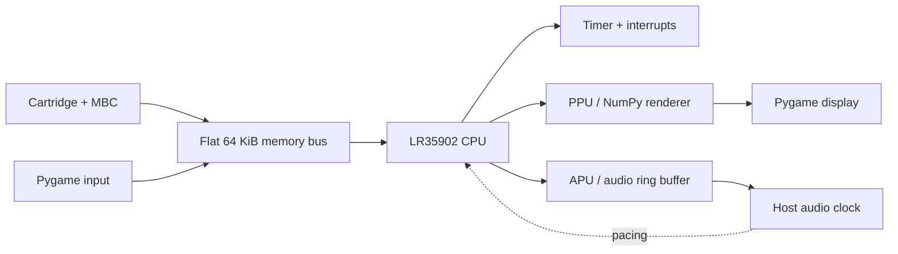

# PyGameBoy

[](https://github.com/Obscuretone/pygameboy/actions/workflows/ci.yml)
[](pyproject.toml)
[](https://obscuretone.com/pygameboy/)
[](https://www.python.org/)
[](LICENSE)

A performance-focused Nintendo Game Boy and Game Boy Color emulator written in
Python, Pygame, and NumPy.



PyGameBoy explores a specific engineering question: how far can a readable,
tested CPython emulator go when its hottest paths are designed around Python's
cost model? The result combines a flat 64 KiB memory bus, pre-bound opcode
dispatch, vectorized scanline rendering, and audio-clock pacing.

## Highlights

- Complete legal LR35902 base-opcode dispatch with interrupt and timer support.
- MBC0, MBC1, MBC2, MBC3, and MBC5 cartridge banking.
- DMG and CGB background, window, sprite, palette, VRAM-bank, and WRAM-bank
  support.
- Four-channel APU with bipolar DMG DAC mixing, AC coupling, stereo routing,
  and a lock-protected audio ring buffer.
- Battery-backed cartridge saves written with atomic file replacement.
- Hold **R** to rewind approximately ten seconds, with a live history meter and
  a sampled tape-rewind effect. Reverse deltas restore hardware; the CPU and PPU
  regenerate the screen without retaining pixel history.
- Fast frame execution plus an instrumentable single-step/profile path.
- Toggleable live register, PPU, audio-buffer, and timing overlay with separate
  emulated-frame, presented-frame, skipped-frame, and clock-speed telemetry.
- Bundled Obscuretone Test ROM checks with live display/serial progress, every
  legal CPU opcode, every CB opcode, hardware subsystems, and MBC variants.
- Unit, integration, headless CLI, and external test-ROM checks on Python
  3.10–3.13.

Pixel-FIFO timing, channel-1 frequency sweep, portable save-state files, and
complete CGB hardware conformance remain future work.

## Quick start

```bash
git clone https://github.com/Obscuretone/pygameboy.git
cd pygameboy
python -m venv .venv
source .venv/bin/activate
python -m pip install -e .
pygameboy path/to/game.gb
```

Audio output is enabled by default. Pass `--no-audio` if PortAudio or an output
device is unavailable.

PyGameBoy does not include commercial game ROMs or Nintendo firmware. Supply
ROMs that you are legally entitled to use. By default, PyGameBoy runs its own
original 256-byte boot firmware: `PYGAMEBOY` scrolls into view and, on Color
cartridges, a larger berry/grape/kiwi/dandelion/teal `COLOR` line appears
underneath.
The emulated pulse channel plays a two-note chime before the cartridge starts.
Use `--skip-boot-logo` for an instant, documented post-boot state, or supply a
256-byte DMG image you are legally entitled to use:

```bash
pygameboy --boot-rom /path/to/DMG_ROM.bin path/to/game.gb
```

The built-in image contains no Nintendo code, logo data, or recorded audio.
Maintainers should also follow the
[firmware/history policy](docs/firmware.md) before publishing a repository that
previously contained firmware.

## Controls

| Game Boy | Keyboard |
|---|---|
| D-pad | Arrow keys |
| A | Z |
| B | X |
| Start | Enter |
| Select | Space or Right Shift |
| Debug overlay | F1 |
| Rewind | Hold R; release to resume |

## Hardware rewind



Hold **R** to move backward; release it to resume with the keys currently held.
The game overlay shows only the history bar. The annotated animation above uses
an original demonstration ROM and shows hardware values as the timeline changes.

Rewind reverses recorded changes to the emulated hardware: CPU registers, RAM,
cartridge banks, timers, PPU and APU state. Pixels are regenerated by executing
one frame from the restored hardware; no screen history is stored. The default
history holds about ten seconds, capped at 64 MiB of retained payload (current
hardware state plus compressed reverse deltas, excluding Python container
overhead). Releasing R discards the abandoned future. Game audio is replaced by
a sampled rewind effect while R is held; `--no-audio` silences both. The bundled
[CC0 sample and its source](pygameboy_assets/CREDITS.md) are credited to
Hajisounds. The original short effect is time-stretched to ten seconds while
retaining its pitch, and plays once per hold before falling silent. The APU's
internal state is restored, but queued host audio is cleared rather than recorded.

History lives only in the current process. Battery saves follow the restored
timeline when next flushed, including on exit. MBC3 RTC cartridges use emulated
time during recording so holding rewind does not advance their clock.

The history keeps one detached hardware state and compressed XOR changes to
earlier states. Restoring a pre-frame state and executing its recorded run
budget reproduces scanline effects that cannot be recovered by rendering only
the final VRAM and register values. This provides frame-level hardware undo;
CPU instructions still execute forward during display reconstruction.

In a local 900-frame Pokémon Crystal workload, both implementations retained
600 reverse transitions and reproduced the same hardware and pixels through
600 backward frames followed by 600 resumed frames:

| Hardware history | Retained payload |
|---|---:|
| Full compressed states, reference backend | 20,302,065 bytes |
| Compressed reverse deltas, default backend | 2,057,613 bytes |

That is about 90% less retained payload for this workload, including the current
uncompressed hardware state and excluding Python container overhead. It is not
a whole-process memory measurement. The [recorded comparison](benchmarks/rewind-crystal-2026-11-07.json)
uses the same capture and frame reconstruction in both backends; the ROM and
save are user-supplied and are not distributed. A [three-run synthetic comparison](benchmarks/rewind-demo-2026-11-07.json)
uses the original demo ROM below. See the [rewind architecture](ARCHITECTURE.md#rewind-history)
for state ownership, history limits and replay boundaries.

An original demonstration ROM and a GIF can be generated without game downloads:

```bash
uv run --frozen --extra dev python tools/generate_rewind_demo.py --output /tmp/pygameboy-rewind
uv run --frozen pygameboy --skip-boot-logo /tmp/pygameboy-rewind/rewind-demo.gb
```

Use Left/Right to move the ship, hold R to rewind, then change direction.

Compare reverse deltas with a full hardware snapshot reference and verify every
retained backward frame against its original hardware and pixels:

```bash
uv run --frozen --extra dev python -m tools.benchmark_rewind --output /tmp/rewind-benchmark.json
```

## Runtime options

```text
--scale N              Integer display scale
--no-audio             Disable audio output
--rewind-seconds N     History length (default: 10, with a 64 MiB memory cap)
--no-rewind            Disable recording and retain frame-skipping optimizations
--skip-boot-logo       Skip the built-in PyGameBoy boot animation
--no-realtime          Run without host-clock throttling
--profile              Print the hottest executed opcodes on exit
--slow-step            Use the instrumentable dispatch path
--max-frames N         Stop after N host frames
--max-instructions N   Stop after N CPU dispatches
--max-cycles N         Stop after N emulated cycles
```

Run `pygameboy --help` for the complete command reference.

## Architecture



The performance model and its correctness invariants are documented in
[ARCHITECTURE.md](ARCHITECTURE.md). The important design choice is that reads
stay flat while side-effecting writes are routed through a 256-entry page table.
MBC callbacks keep the visible ROM and cartridge-RAM windows synchronized after
bank changes and controller-specific writes.

## Quality and benchmarks

Install the development tools and run the same checks used in CI:

```bash
python -m pip install "uv==0.12.0"
uv sync --frozen --extra dev
uv run --frozen ruff check .
uv run --frozen ruff format --check .
uv run --frozen mypy .
uv run --frozen pytest --cov=. --cov-report=term-missing
uv run --frozen python audit_cpu.py
uv run --frozen pygameboy-conformance tests/roms/mooneye
```

CI enforces 100% statement and branch coverage across every production module.
The suite combines the reproducible
[Obscuretone Test ROM](https://github.com/Obscuretone/obscuretone-test-rom),
exhaustive opcode matrices,
synthetic-ROM system tests, hardware state-machine tests, renderer checks, host
failure-path coverage, and pinned Mooneye acceptance ROMs.

CPU microbenchmarks exercise the same production max-cycle dispatch loop used
for normal frames. They use one warm-up followed by median measured runs.
Results include interpreter, platform, clock target, execution path, and raw
JSON so comparisons remain auditable:

```bash
uv run python benchmark_cpu.py \
  --repeats 5 \
  --json benchmarks/latest.json \
  --markdown BENCHMARKS.md
```

See the checked-in [benchmark report](BENCHMARKS.md). It measures isolated CPU
dispatch throughput, not whole-emulator compatibility or frame rate.

## Compatibility philosophy

Passing project tests is necessary but not sufficient for emulator accuracy.
New hardware behavior should be tested through the integrated `Memory`/`CPU`
path, not only through a component in isolation. The headless conformance
runner understands OTR's `OTR/1` events and mailbox, Mooneye register
signatures, and Blargg serial/memory reports. The published floor covers CPU
instructions, instruction timing, memory-access timing, DMA, timer,
serial-clock, and register behavior.

See [test-ROM conformance](docs/conformance.md) for the pinned provenance,
current scope, external-suite commands, result semantics, and the GitHub Pages
compatibility-dashboard deployment.

## Contributing

See [CONTRIBUTING.md](CONTRIBUTING.md) for the development workflow and the
performance-change checklist.

## License

PyGameBoy source code is available under the [MIT License](LICENSE). Nintendo,
Game Boy, and related marks belong to their respective owners.
